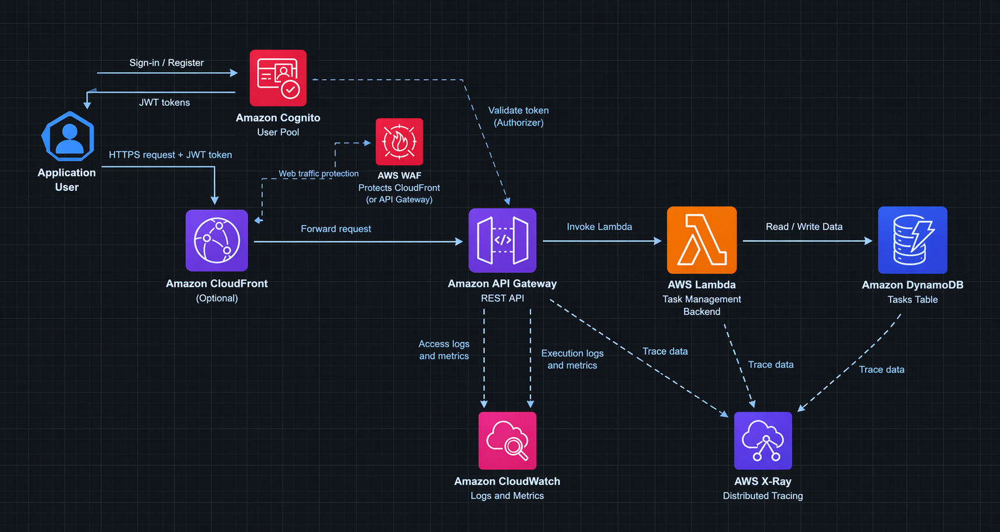
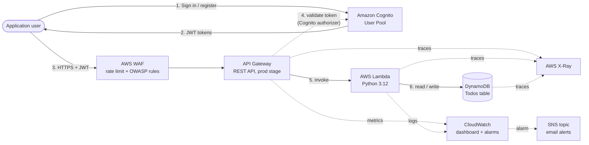

# Serverless REST API with Cognito Auth, DynamoDB & WAF


A secure, fully serverless REST API for task management. Users sign in with **Amazon Cognito**, call an **API Gateway** REST API protected by **AWS WAF**, which invokes a **Lambda** function that stores data in **DynamoDB**. Everything is observed with **CloudWatch** and **X-Ray**, and the whole stack is deployed with one command using **AWS SAM (IaC tool)**.

## Architecture



What is deployed by this repository (CloudFront is optional in the diagram and is not deployed here)



### Request flow
1. The user signs up / signs in with Cognito and receives JWT tokens.
2. The client calls the API with the `Authorization: <IdToken>` header.
3. **WAF** inspects the request (per-IP rate limit and the AWS Common Rule Set) before it reaches API Gateway.
4. **API Gateway** validates the JWT with the Cognito authorizer. Invalid or missing token returns `401`.
5. **Lambda** reads the user id from the token claims (`sub`) and runs the operation.
6. **DynamoDB** stores each task under `userId` (partition key), so a user can only access their own data.
7. CloudWatch collects metrics and logs, X-Ray traces the full call chain, and an alarm emails you through SNS if errors appear.

## AWS services and why they were chosen

| Service | Role in the solution | Why |
|---|---|---|
| **Amazon Cognito** (User Pool) | Sign-up, sign-in, JWT issuing | Managed identity, no auth code to maintain, native API Gateway authorizer |
| **Amazon API Gateway** (REST) | Public HTTPS entry point, routing, authorizer, throttling | Supports WAF, X-Ray, usage throttling and Cognito authorizers |
| **AWS WAF** (Regional Web ACL) | Rate-based rule + AWS Managed Common Rule Set | Protects against abusive traffic and common OWASP-style attacks before they reach the backend |
| **AWS Lambda** | CRUD business logic (Python 3.12) | No servers, scales automatically, pay per request |
| **Amazon DynamoDB** | Task storage, on-demand capacity, GSI, Streams | Single-digit ms latency, no capacity planning, encrypted at rest |
| **Amazon CloudWatch** | Metrics, dashboard, alarms | Central observability |
| **Amazon SNS** | Alarm notifications by email | Simple alerting |
| **AWS X-Ray** | Distributed tracing API Gateway → Lambda → DynamoDB | Find latency and errors across the call chain |
| **AWS SAM / CloudFormation** | Infrastructure as Code | Repeatable, reviewable, one-command deploy and cleanup |

## Data model

Table `Todos` (on-demand):

| Attribute | Type | Notes |
|---|---|---|
| `userId` | String, **partition key** | Cognito `sub` claim |
| `todoId` | String, **sort key** | UUID |
| `title` | String | 1–200 characters |
| `status` | String | `open` or `done` |
| `createdAt`, `updatedAt` | String | ISO 8601 UTC |

**GSI `StatusIndex`** (`userId` + `status`) serves `GET /todos?status=done`. DynamoDB Streams are enabled (`NEW_AND_OLD_IMAGES`) so downstream processing can be added later.

## API reference

All endpoints require `Authorization: <Cognito IdToken>`.

| Method | Path | Body | Success | Errors |
|---|---|---|---|---|
| POST | `/todos` | `{"title": "...", "status": "open"}` | `201` + item | `400` validation |
| GET | `/todos` | query `?status=open\|done` (optional) | `200` + list | `400` invalid status |
| GET | `/todos/{id}` | — | `200` + item | `404` |
| PUT | `/todos/{id}` | `{"title"?: "...", "status"?: "..."}` | `200` + updated item | `400`, `404` |
| DELETE | `/todos/{id}` | — | `204` | `404` |

Other responses: `401` missing/invalid token, `403` blocked by WAF, `429` throttled by API Gateway.


## Well-Architected mapping

| Pillar | How it is addressed |
|---|---|
| Security | Cognito, authorizer, WAF, least-privilege IAM, per-user data isolation, encryption at rest |
| Reliability | Managed multi-AZ services (API Gateway, Lambda, DynamoDB), throttling, alarms |
| Performance efficiency | Serverless auto-scaling, DynamoDB on-demand, GSI for the status query |
| Cost optimization | Pay-per-use everywhere, no idle compute, only two WAF rules |
| Operational excellence | Infrastructure as Code, automated tests, dashboard, alarms, tracing |
| Sustainability | No always-on servers |


## Deployment

### Prerequisites
- An AWS account ( I used a Free plan account ), and the AWS CLI configured (`aws configure`)
- [AWS SAM CLI](https://docs.aws.amazon.com/serverless-application-model/latest/developerguide/install-sam-cli.html)
- Python 3.12 (or add `--use-container` to `sam build` if you have Docker)

### Deploy
```bash
./scripts/deploy.sh eu-west-1
```


### Cleanup
```bash
./scripts/cleanup.sh eu-west-1
```


